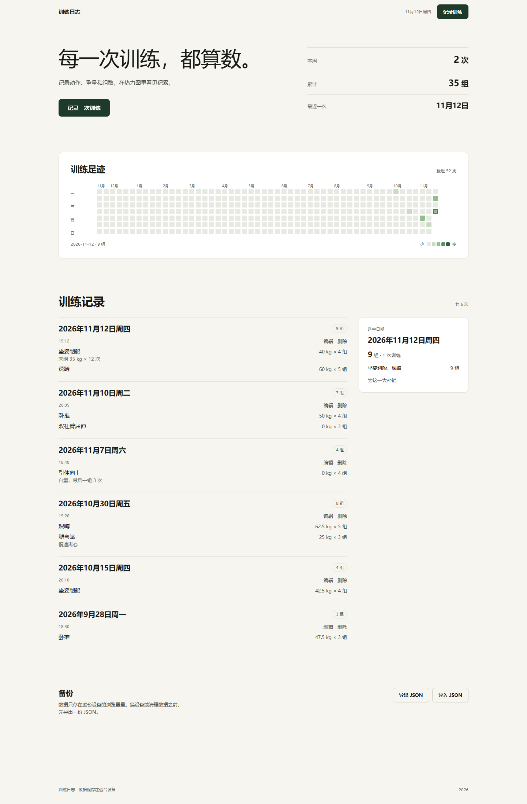
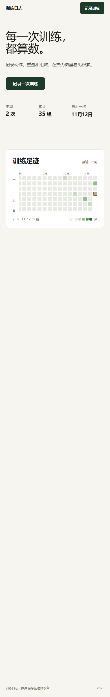

# 训练日志

手机优先的中文健身训练日志：选动作、带出上次的起始重量、填组数，用一张热力图回看最近 52 周。

**在线使用** → https://z131a634-wesley.github.io/training-log/



## 为什么做这个

器械之间只有几十秒，大多数训练 App 要点击四五次才能记一组。这里只做一件事：**打开 → 填动作和重量 → 保存**，一屏内完成。

## 能做什么

- **记录训练**：一次训练可以加多个动作，每个动作记名称、起始重量（kg）、组数和可选备注；`0 kg` 表示自重。同一天可以存多次训练，也支持补记过去的日期。
- **自动带出重量**：输入历史动作时，自动填入「训练日期当天或之前、最近一次」的起始重量。比如上次「坐姿划船 40 kg × 4 组，备注：末组 35 kg × 12 次」，这次带出的就是 **40 kg** —— 备注不参与计算。
- **热力图**：最近 52 周，每周从周一开始，按当天总组数上色。鼠标悬停看摘要，点击（或手机轻点）查看当天详情；键盘可以用方向键移动、回车查看。
- **历史**：按日期分组，显示当天总组数、每次训练的保存时间；可编辑、删除。
- **备份**：导出 / 导入 JSON。导入前会校验格式和版本，确认后才替换本机记录。



## 数据存在哪里（重要）

**没有服务器，没有账号，没有同步。** 记录存在浏览器的 `localStorage` 里，键名 `training-log:sessions`。

数据按「设备 × 浏览器 × 网址」隔离：

| 场景 | 能否看到原记录 |
| --- | --- |
| 同一台手机、同一个浏览器 | ✅ |
| 换一台设备 / 换一个浏览器 | ❌ 各记各的 |
| 无痕窗口 | ❌ 关闭即清空 |
| 线上地址 ↔ 本地开发地址 | ❌ 视为两个独立来源 |

会**永久丢失**的情况：清除浏览器数据、卸载浏览器、换设备、以及 iOS Safari 对长期不访问的网站自动清理本地存储。

所以：**唯一的跨设备方式，也是唯一的防丢手段，是定期点「导出 JSON」**。建议每周导出一次，存到网盘或聊天记录里。

## 本地开发

需要 Node 24（见 `.node-version`）：

```bash
npm ci          # 安装依赖
npm run dev     # 本地开发服务器 http://127.0.0.1:5173
npm run verify  # 类型检查 + 测试 + 生产构建
```

`npm run verify` 是提交前的唯一门禁：`vue-tsc --noEmit` → `vitest run` → `vite build`。

## 发布

发布走 GitHub Actions + GitHub Pages，但**不是每次 push 都发布**：

- push 到 `main`：只跑验证，不发布
- 要发布：Actions → **Verify and publish** → **Run workflow** → 分支选 `main`，`release_sha` 填**当前 main 的完整提交 SHA**

工作流会先校验「分支是 main 且 SHA 完全一致」，不一致直接失败——避免把没验证过的提交发上线。用命令行也可以：

```bash
gh workflow run verify.yml --repo Z131A634-Wesley/training-log --ref main \
  -f release_sha=$(git rev-parse main)
```

## 技术栈

| 层面 | 选型 |
| --- | --- |
| 框架 | Vue 3.5（单文件组件，无路由、无状态库） |
| 语言 | TypeScript 5.9（strict） |
| 构建 | Vite 8，`base: './'` 适配 Pages 子路径 |
| 测试 | Vitest 4（纯函数 + 注入式存储，不需要 jsdom） |
| 样式 | 手写 CSS，设计令牌 + 组件级 scoped 样式，无 UI 框架 |
| 部署 | GitHub Actions → GitHub Pages |

运行时依赖只有 Vue 一个，其余都是构建期工具。

## 项目结构

```
src/
  App.vue              页面骨架：导航、首屏、表单开合、历史与侧栏
  components/          表单、热力图、历史、备份四个组件
  domain/              日期与训练规则（纯函数，全部有测试）
  storage/             本地存储、备份校验、旧格式迁移
  ui/reveal.ts         进入视口时淡入一次（尊重 prefers-reduced-motion）
  style.css            设计令牌与全局样式
docs/
  v1-plan.md           功能范围、开发顺序与验收标准
  design-system.md     视觉规范：颜色、字体、间距、组件、动效上限
  screenshots/         本文档用的截图
```

规则写在 [`AGENTS.md`](AGENTS.md)：界面 / 规则 / 存储三层分开，训练记录是唯一数据源，默认重量和热力图都从记录现算。

## 测试覆盖

37 个用例，重点在容易出错的地方：

- 默认重量：同日按保存时间、忽略未来记录、`0 kg` 有效、备注不参与
- 日期：跨年、夏令时切换、真实日历日校验（`2026-02-29` 会被拒）
- 存储：损坏数据不静默覆盖、写入失败保留原值、备份往返
- 迁移：合并前那一版（字段叫 `weight`）的记录能被一次性导入且不重复

## 设计

视觉规范见 [`docs/design-system.md`](docs/design-system.md)。三条硬约束：

1. 字号只有 6 档、间距只有 9 档（4px 基准）、圆角只有 4 种
2. 品牌色（深绿）只用于动作，热力图用独立的一套色阶，两者不混用
3. 暖色只有一个（赤陶），只标记「今天 / 当前选中」

动效只有两种：首屏上浮淡入、区块进视口淡入，且 `prefers-reduced-motion` 下全部关闭。

## 已知限制

- 不跨设备同步、无账号（V1 范围外）
- 不支持 CSV 导出、逐组记录
- iOS Safari 对超过 7 天未访问的网站可能清理本地存储

## 许可

个人项目，未声明开源许可。如需复用代码请先确认。
